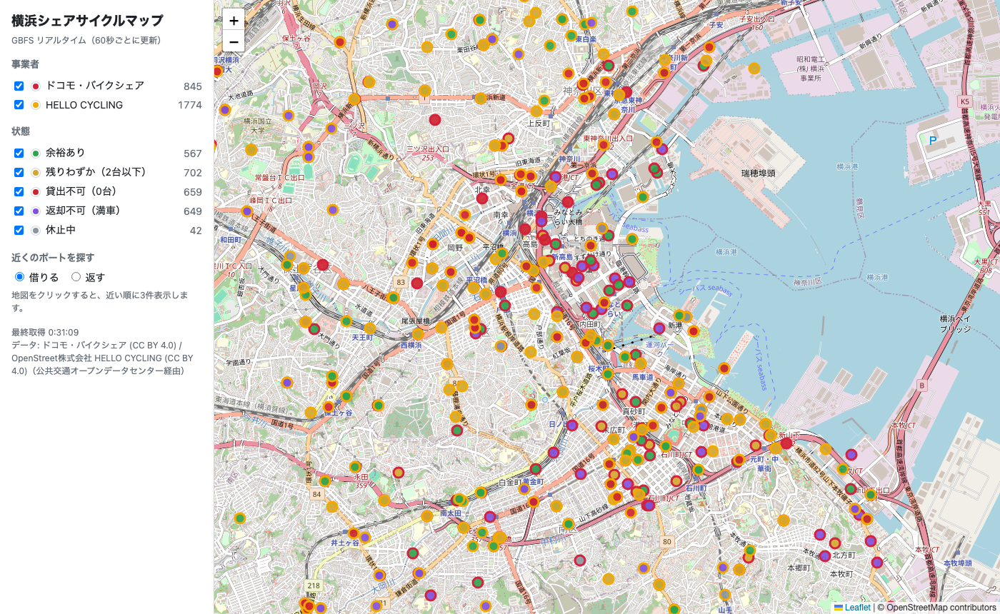

# gbfs_yokohama_demo

Realtime bike-share map of Yokohama built on [GBFS](https://gbfs.org/) feeds from two operators:



| Operator | Feed (via ODPT public API, no key) | License |
|---|---|---|
| docomo bike share (includes Yokohama "baybike") | `https://api-public.odpt.org/api/v4/gbfs/docomo-cycle/gbfs.json` | CC BY 4.0 |
| HELLO CYCLING (OpenStreet) | `https://api-public.odpt.org/api/v4/gbfs/hellocycling/gbfs.json` | CC BY 4.0 (one of CC BY / ODC-BY / ODbL) |

Both feeds are GBFS v2.3 and station-based (no `free_bike_status` / `geofencing_zones`).

The `api-public` endpoint needs no account: per the [ODPT developer site terms](https://developer.odpt.org/terms), data published under CC0 / CC BY 4.0 / ODC-BY / ODbL can be used without registration, following each license (CC BY requires attribution).

## Run

```bash
docker compose up -d --build
```

Open http://localhost:8120/ . Tests: `docker compose run --rm web python -m pytest -q`.

## How it works

```
browser (Leaflet) ──▶ FastAPI ──▶ ODPT GBFS feeds
                       │  gbfs.json → feed URLs (v2 and v3 layouts)
                       │  station_information ⋈ station_status by station_id
                       └─ TTL cache per feed, stale-on-error
```

- `app/gbfs.py` – discovery, TTL-aware cache, normalization (`merge_stations`), status classification.
- `app/main.py` – API and operator config. The area is a bounding box (`BBOX` env, default ≈ city of Yokohama).
- `static/` – map UI (Japanese).

### API

- `GET /api/stations` – operators (with attribution, counts, errors) and normalized stations.
- `GET /api/nearest?lat=&lon=&want=rent|return&limit=3` – nearest stations where you can rent / return.

### Quirks handled

- Each file's `ttl` is honored, but `station_information` gets a 1 h minimum: HELLO CYCLING's is ~8 MB and advertises `ttl: 60`.
- HELLO CYCLING puts capacity in `vehicle_capacity` as a string; docomo uses `capacity` as an integer.
- v3 field names (`num_vehicles_available`, localized name arrays) are accepted too, so v3 feeds can be added without code changes.
- If one operator's feed fails, the other is still shown and the failing one is flagged in the UI.

## Data, attribution and license

- No GBFS data is stored in this repository; it is fetched from the feeds at runtime. Tests use small hand-written fixtures.
- Data: docomo bike share, OpenStreet Corp. (HELLO CYCLING), via the Public Transportation Open Data Center (ODPT), CC BY 4.0. The UI shows this credit. If you store or redistribute the data (e.g. status history dumps), keep the credit and note that it was modified.
- Map tiles © OpenStreetMap contributors. Heavy use should switch to another tile provider per the [OSM tile usage policy](https://operations.osmfoundation.org/policies/tiles/).
- "docomo bike share" and "HELLO CYCLING" are trademarks of their respective owners. This project is an independent demo and is not affiliated with or endorsed by them or ODPT. Station data may be delayed or inaccurate; don't contact the operators about what this app shows.
- The code is released under the [MIT License](LICENSE). It covers the files written for this project (source code, Docker/config files, docs, and the app UI in the screenshot), not the third-party content above: the GBFS station data (only stored in `docs/screenshot.png`), the OpenStreetMap tiles and map data, and Leaflet (loaded from a CDN, BSD-2-Clause).

## Ideas for next steps

- Record `station_status` snapshots into PostGIS/TimescaleDB and chart empty/full rates by hour and weekday.
- Combine with `../pgrouting_yokohama_demo` for walk → bike → walk routing.
